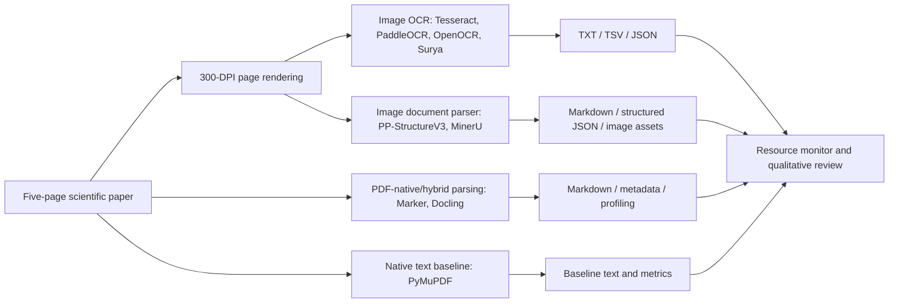
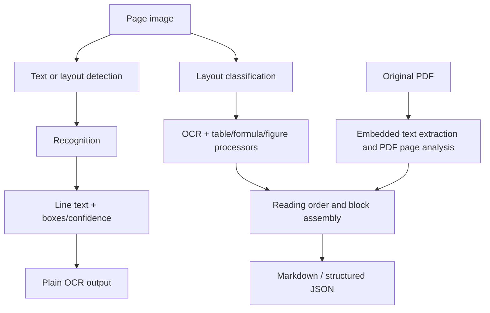

# OCR and Document Understanding Benchmark

This repository investigates how traditional OCR engines, layout-aware document understanding systems, and PDF-native extraction pipelines differ in processing cost, resource use, and reconstruction of a scientific paper. Eight systems were evaluated on five pages from *Attention Is All You Need*.

The comparison is intentionally broader than a speed ranking. Text detection and recognition do not by themselves recover reading order, table cells, equations, figures, or document hierarchy. The benchmark therefore records input mode, pipeline stages, outputs, runtime, memory, and observed structural limitations.

> **Benchmark caveat:** the systems did not all receive the same representation. Tesseract, PaddleOCR, OpenOCR, Surya, PP-StructureV3, and MinerU received rendered page images. Marker and Docling received the original PDF. Results are useful as a workload comparison, not a fully controlled model-only leaderboard.

## Research questions

- How much time does each framework spend in initialization, inference or document assembly, and the full monitored process?
- What are the observed process-tree RAM costs and, where available, GPU readings?
- How well are prose, reading order, headings, tables, equations, diagrams, and spatial relationships retained?
- Which pipelines generate useful Markdown or structured JSON, and what quality or resource trade-offs accompany that structure?
- When does embedded PDF text make extraction fundamentally different from OCR over page pixels?

## Systems and categories

| System | Category in this benchmark | Actual input and device | Pipeline and output |
|---|---|---|---|
| [Tesseract](https://github.com/tesseract-ocr/tesseract) | Traditional OCR | 300-DPI page PNGs; CPU | PyMuPDF rendering, LSTM OCR with `--oem 1 --psm 3`; TXT and TSV with word boxes and confidence. TSV is token-level evidence, not reconstructed tables. |
| [PaddleOCR](https://github.com/PaddlePaddle/PaddleOCR) | Neural OCR | 300-DPI page PNGs; GPU `gpu:0` | PaddleOCR 3.x detection and recognition; JSON stores recognized text, confidence, and polygons, with combined text output. Detection regions and polygons do not establish table cell relationships. |
| [OpenOCR](https://github.com/Topdu/OpenOCR) | Neural OCR via ONNX | 300-DPI page PNGs; CPU final run | ONNX Runtime detection and recognition; per-page timing separates detection and recognition, and parsed JSON retains region records. The CUDA execution provider failed on Windows with DLL loading error 126, so the reported run is CPU. |
| [Surya](https://github.com/VikParuchuri/surya) | Neural OCR with detection | 300-DPI page PNGs; CPU | `FoundationPredictor`, `DetectionPredictor`, and `RecognitionPredictor` detect and recognize text lines; JSON retains polygons and confidence. The inspected output is line-oriented rather than a table or equation representation. |
| [PP-StructureV3](https://github.com/PaddlePaddle/PaddleOCR) | Layout-aware image parsing | 300-DPI page PNGs; CPU | PP-StructureV3 performs document layout parsing with OCR and structure-oriented output; this run exported page JSON and Markdown. Its extra stages increase latency and memory relative to line OCR. |
| [MinerU](https://github.com/opendatalab/MinerU) | Document parsing with OCR | Five rendered page PNGs; CPU, basic tier, ONNX backend | `mineru-kit parse` ran with OCR parse mode, producing page blocks, Markdown, JSON, and image assets. This benchmark did **not** use a VLM model. |
| [Marker](https://github.com/datalab-to/marker) | Hybrid PDF parsing / text extraction | Original PDF; CPU | Fast Markdown conversion with `text_extraction_method: pdftext`, layout and document blocks, table and figure extraction. Equation OCR was disabled because the initial equation-processing path invoked a Docker-dependent backend. This is not pure image OCR. |
| [Docling](https://github.com/docling-project/docling) | PDF document parsing with OCR | Original PDF; CPU | Standard pipeline with Tesseract OCR, layout analysis, table structure, page assembly, reading order, and document assembly; Markdown and profiling JSON. Its inspected Markdown contains `formula-not-decoded` placeholders. |

The implementation detail and configuration evidence is in [docs/framework_architectures.md](docs/framework_architectures.md) and [docs/implementation_details.md](docs/implementation_details.md).

## Benchmark architecture

## Methodology

- Source document: Vaswani et al., *Attention Is All You Need* (2017); see [references/README.md](references/README.md).
- Five selected pages were represented as 300-DPI, 2550 × 3300 pixel page images for image-based systems.
- Tesseract, PaddleOCR, OpenOCR, Surya, and PP-StructureV3 use rendered images. OpenOCR and Surya read the Tesseract render directory. MinerU was invoked on the same five rendered PNGs.
- Marker and Docling use the original PDF. Marker metadata confirms `text_extraction_method: pdftext`; Docling's standard pipeline has OCR enabled with Tesseract and table processing enabled.
- A separate PyMuPDF native text extraction is a reference baseline, **not OCR**.
- Framework environments were installed separately. Existing local environments are not a portable version lock and are not included in Git.
- `scripts/monitor.py` samples process-tree CPU, RSS memory, I/O, and optional NVML GPU values at one-second intervals. It reports elapsed time and disk delta to the console. Resource CSVs preserve samples; GPU readings are device-global, not attributable per process.

See [docs/benchmark_methodology.md](docs/benchmark_methodology.md) for caveats and [docs/reproduction.md](docs/reproduction.md) for commands.

## Performance results

Times are deliberately separated by measurement boundary. `N/R` means the project did not record a comparable value. Process-tree RAM is the sampled maximum from the selected resource CSV. Disk delta was printed by the monitor but was not stored in these CSVs, so it is `N/R` here.

| Framework | Device | Input mode | Init (s) | Reported inference / pipeline / CLI time (s) | Monitor elapsed (s) | Peak process-tree RAM (MB) | GPU memory observed (MB, global) | Disk delta (MB) |
|---|---|---|---:|---:|---:|---:|---:|---:|
| Tesseract | CPU | Rendered images | N/R | 11.1193 OCR (sum of stored page timings); 12.5842 total wall including render and writes | 15.70 | 494.4 | 142.0 | N/R |
| PaddleOCR | GPU `gpu:0` | Rendered images | N/R | 17.5065 inference | 30.91 | 1918.3 | 4770.5 | N/R |
| OpenOCR | CPU | Rendered images | N/R | 25.1599 inference wall time | 26.86 | 720.8 | 142.0 | N/R |
| Surya | CPU | Rendered images | 14.7379 | 561.0377 inference | 584.66 | 5449.3 | 142.0 | N/R |
| PP-StructureV3 | CPU | Rendered images | 71.1789 | 1653.3291 inference | 1745.75 | 7598.1 | N/R | N/R |
| MinerU | CPU | Rendered images; OCR mode | N/R | N/R | 45.45 | 3154.5 | N/R | N/R |
| Marker | CPU | Original PDF; `pdftext` | N/R | 5.6135 CLI | 19.28 | 447.5 | N/R | N/R |
| Docling | CPU | Original PDF; standard parse | N/R | 21.407 pipeline | 60.70 | 1657.1 | N/R | N/R |

The selected resource logs and framework metric/timing artifacts are catalogued in [benchmarks/final_comparison.csv](benchmarks/final_comparison.csv). GPU memory for Tesseract, PaddleOCR, OpenOCR, and Surya is a global device reading. The 142 MB values are idle/global readings, not memory allocated by those CPU processes. Do not infer per-process GPU efficiency from this column.

Docling's profiling JSON reports a 21.407-second pipeline total. Summing its recorded per-stage arrays gives 5.891 s for layout, 2.515 s for OCR, 14.172 s for table structure, 0.594 s for page parsing, 0.063 s for layout post-processing, 0.610 s for document assembly, and 0.032 s for reading order. These stage totals are profiling scopes and are not additive substitutes for the pipeline total.

### Resource interpretation

The heavier CPU runs show a visible cost for model initialization and multi-stage parsing: Surya sampled 5.45 GB peak process-tree RAM and PP-StructureV3 7.60 GB, compared with 0.49 GB for Tesseract and 0.72 GB for OpenOCR in their selected runs. These are measurements from one Windows host and one sampling interval, not intrinsic framework limits. Surya and PP-StructureV3 also spent far longer per page than lightweight OCR, while producing richer detection/layout data. MinerU and Docling likewise include document-level work beyond transcription. Model storage and cold-start behavior depend on separately downloaded weights and are not normalized by these measurements.

## Output quality findings

No numerical accuracy score is reported: the repository does not contain a truth-annotated set of word boxes, table cells, equations, or figure relationships. The comparison below is qualitative and tied to the inspected output artifacts.

| Framework | Prose and reading order | Headings / spatial data | Tables | Equations | Figures and structure |
|---|---|---|---|---|---|
| Tesseract | Readable text in approximate page order | TSV has word boxes and confidence; no semantic hierarchy | Tokens/lines only; not table reconstruction | Symbols and layout are fragile | No document-level figure extraction |
| PaddleOCR | Readable line output, 408 detected lines across the sample | JSON has polygons and confidence; no heading tree | Detection polygons do not encode row/column relationships | Not a formula parser | No explicit document assembly |
| OpenOCR | Readable line output, 396 recognized lines; reported mean score is recorded in metrics | Parsed region JSON; no semantic hierarchy | No verified cell grid | No formula structure | OCR regions only |
| Surya | 406 recognized lines; long CPU inference on this run | Text line polygons and confidence | No verified row/column reconstruction | Output remains line text, not equation markup | No full document model |
| PP-StructureV3 | Markdown reading order and page structures are richer than line OCR | Page-level JSON/Markdown; layout-aware output | Table-capable pipeline, but cell fidelity was not ground-truth scored | Formula handling exists in the pipeline; inspected math can be malformed (for example a broken `LayerNorm` expression) | Image regions and captions can be emitted |
| MinerU | Blocks preserve prose with spatial bounding boxes | `paragraph_title` blocks and normalized boxes in structured JSON | Structured extraction is available, but this audit did not establish exact cell fidelity | Math is emitted LaTeX-like, but symbols can be split (`d _ { ... } = 5 1 2`) | Image blocks, captions, and extracted assets are present |
| Marker | Fluent text and headings from the PDF text layer; not pixel OCR | Document hierarchy and page anchors; figure files extracted | Markdown table extraction is useful but not proof of cell-level fidelity | Equation OCR disabled; math therefore depends on PDF text handling and may be incomplete | Diagram JPEGs and captions are retained |
| Docling | Structured Markdown and reading order | Layout, page assembly, and document assembly stages | Table 2 structure is present, but several cell values are missing and scientific notation is corrupted; Table 3 alignment/merged-cell fidelity is not formally verified | Attention and positional-encoding content contain `formula-not-decoded` placeholders; not successful equation reconstruction | Figure image and caption are present, but spatial relationships are not fully represented in Markdown |

### Three tables, equations, and diagrams

- **Table 1, complexity comparison:** line-based OCR can read many cell strings but does not reliably preserve row/column boundaries, math symbols, or superscript relationships. Markdown/JSON parsers represent more layout, but no cell-by-cell truth comparison exists.
- **Table 2, BLEU scores and training costs:** Docling emits a table structure, but the inspected Markdown misses several cell values and corrupts scientific notation. Structure detection must not be mistaken for faithful value extraction. Marker’s Markdown is a useful comparison example, not validated ground truth.
- **Table 3, model variations and hyperparameters:** header and row alignment are vulnerable to multi-line labels and merged cells. Extracted Markdown is indicative, not a verified relational table.
- **Attention and positional encoding:** Marker had equation OCR disabled. MinerU emits LaTeX-like strings with spaced symbols; PP-StructureV3 output can contain malformed math. Docling's output contains `formula-not-decoded` placeholders, so equations were not decoded there.
- **Diagrams:** Marker extracts diagram JPEGs; MinerU retains image blocks, assets, and captions; Docling embeds images and captions in Markdown; PP-StructureV3 emits image regions. Detection/extraction does not guarantee recovery of labels, arrows, or spatial relationships as machine-readable graph structure.
- **Character encoding:** outputs are written as UTF-8 by the local runners. This avoids an intended encoding conversion, but does not guarantee that each model recognized Greek symbols, superscripts, or subscripts correctly.

Examples: [Tesseract text and TSV](outputs/examples/tesseract/), [PaddleOCR JSON](outputs/examples/paddleocr/), [OpenOCR parsed JSON](outputs/examples/openocr/), [Surya page JSON](outputs/examples/surya/), [PP-StructureV3 Markdown/JSON](outputs/examples/ppstructurev3/), [MinerU structured output](outputs/examples/mineru/), [Marker Markdown/metadata](outputs/examples/marker/), [Docling Markdown/timings](outputs/examples/docling/).

## Findings and workload fit

- Traditional and neural OCR perform text detection/recognition; bounding boxes and confidence are not document understanding.
- Table detection and table reconstruction are different capabilities. Row/column relations and values need explicit validation.
- Formula extraction is distinct from ordinary OCR. Marker disabled equation OCR, and Docling's inspected output has undecoded formula placeholders.
- Layout-aware systems generate richer reading order and structured representations, at substantially higher runtime and memory cost in these CPU runs.
- PDF-native extraction can be efficient when a usable embedded text layer exists. Marker explicitly reports `text_extraction_method: pdftext`; it is not comparable to OCR-only image input.
- Fast OCR is suitable when text transcription and boxes are enough. Layout parsers are appropriate when headings, figures, tables, and blocks matter and the additional cost is acceptable. PDF-native extraction is useful when source PDFs have good text layers. None is a universal winner.

Details: [docs/findings.md](docs/findings.md), [docs/quality_assessment.md](docs/quality_assessment.md), [docs/limitations.md](docs/limitations.md).

## Reproduction

This is a Windows PowerShell benchmark. Keep one environment per framework; do not install all frameworks into a single environment. The repository intentionally does not auto-install model stacks. Exact commands and known environment constraints are in [docs/reproduction.md](docs/reproduction.md). The three original commands for MinerU, Marker, and Docling are preserved as scripts under `scripts/`, but their original package versions are not fully pinned.

The source PDF and rendered page images are not included in Git until redistribution rights are confirmed. See [data/README.md](data/README.md) for dataset setup. Existing local environments are not deleted by this preparation task.

## Repository map

- `scripts/`: benchmark runners, native baseline extraction, and resource monitor.
- `configs/`: Marker CPU equation settings.
- `benchmarks/metrics/`: copied final framework metric and timing evidence.
- `benchmarks/resource_logs/`: selected final resource-monitor CSVs.
- `benchmarks/final_comparison.csv`: consolidated values and measurement definitions.
- `outputs/examples/`: selected representative outputs, not the full generated artifact tree.
- `docs/`: methodology, implementation, quality, findings, reproduction, and limitations.
- `ground-truth/native_pdf_baseline/`: local native PDF text-layer reference; not OCR and excluded from Git pending rights review.

Internal audit drafts remain local and are excluded from the curated publication tree; their verified findings have been distilled into `docs/`.

## References, licensing, and publication status

The paper citation and framework documentation are listed in [references/README.md](references/README.md). The source paper and derived page images are excluded pending a redistribution-rights check. No code license has been selected; a public repository should not be treated as open source until its owner chooses and adds a license. See [docs/limitations.md](docs/limitations.md) and [docs/cleanup_report.md](docs/cleanup_report.md).

**Publication status:** the benchmark evidence and technical documentation are organized, but the repository is not fully reproducible from a clean clone because model/package versions and some system prerequisites are not locked. Review the remaining publication issues before pushing publicly.