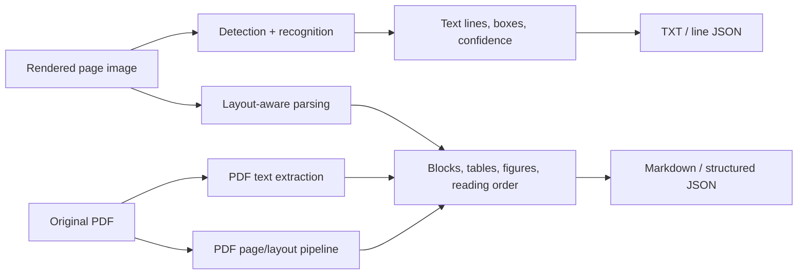

# Framework Architectures

## Processing families

The distinction matters: an OCR recognizer can return correct words but still lose their semantic hierarchy, table cell relations, equation structure, or diagram geometry. This benchmark includes both OCR and document parsing, not eight interchangeable OCR engines.

## Traditional and neural OCR

### Tesseract

The runner rasterizes each page with PyMuPDF at 300 DPI, then calls `pytesseract.image_to_data` with `--oem 1 --psm 3`. OEM 1 selects the LSTM recognition engine; PSM 3 requests automatic page segmentation. TSV retains token text, coordinates, and confidence; the runner groups tokens into lines for TXT. This output is useful for transcription and localization but does not create table cells or semantic headings. Mathematical layout is especially fragile.

### PaddleOCR

PaddleOCR 3.x runs `predict` on each 300-DPI page PNG using English language settings and `device="gpu:0"`. The wrapper extracts recognition text, scores, and `rec_polys` (falling back to detection polygons), serializing these as per-line JSON plus text. Polygons locate text regions; they do not imply row/column semantics or automatically restore complex table structure.

### OpenOCR

The project initializes `OpenOCR(backend="onnx", use_gpu="false")`, invokes its model on each PNG, and records the backend timing object, including detection and recognition durations. A post-processor parses the framework's filename/tab/JSON-array representation into JSON records and combined text. The attempted Windows CUDA provider failed to load with DLL error 126. The final measured run uses CPU and ONNX Runtime 1.20.2; OpenOCR package version in the metrics is 0.1.5.

### Surya

The runner loads `FoundationPredictor`, passes it to `RecognitionPredictor`, and separately loads `DetectionPredictor`. For each page it invokes recognition with the detector, then writes recognized lines with polygon and confidence metadata. The final run is CPU (`torch 2.15.0+cpu`, Surya 0.17.1), with 14.7379 seconds initialization and 561.0377 seconds total inference for five pages. The output is line recognition, not a fully reconstructed scientific document; expressions remain plain line text.

## Layout-aware image parsing

### PP-StructureV3

PP-StructureV3 receives the five rendered page images and runs on CPU with document orientation, unwarping, and text-line orientation disabled. Its pipeline supports layout parsing, OCR, table and formula-oriented processing, chart/document components, and reconstruction. The wrapper saves native JSON and Markdown exports. Initialization takes 71.1789 seconds and the measured inference sum is 1653.3291 seconds. Richer stage coverage and structured exports carry substantial runtime and memory overhead. The output review shows that math can still be malformed; pipeline capability does not guarantee content fidelity.

### MinerU

The recorded invocation supplies five rendered page PNGs to `mineru-kit parse`, selects `--tier basic`, `--format zip`, and `--ocr-mode ocr`; environment variables select the ONNX small-model backend and CPU device. The exported `middle_json.json` identifies MinerU 4.1.4, `tier: basic`, and `parse_mode: ocr`. There is no VLM in this run. Its page blocks include text, `paragraph_title`, image, and caption elements with normalized bounding boxes. Markdown, structured JSON, and extracted image assets are produced. Math and table extraction are part of document parsing, but this repository does not include truth annotations to score them cell-by-cell.

## PDF document pipelines

### Marker

Marker uses the original PDF, page range `0-4`, fast mode, Markdown output, and a single-process CLI run. Metadata records `text_extraction_method: pdftext`, so text came from the PDF's embedded text representation rather than solely from rendered pixels. Marker then produces document blocks, layout structure, Markdown, metadata, and diagram assets. Equation OCR was disabled in the committed configuration because the initial equation processor attempted a Docker-dependent backend. Consequently this result is hybrid PDF parsing, not a pure image OCR result, and it should not be credited with equation OCR.

### Docling

Docling receives the original PDF through its standard CPU conversion pipeline. The recorded CLI explicitly enables OCR, uses Tesseract with English, enables tables, restricts pages to 1-5, sets four threads, and saves profiling. The timing JSON records stages including layout, OCR, table structure, page assembly, reading order, and document assembly. It emits Markdown and timing/profiling JSON. In the inspected result the attention and positional encoding formula regions are `formula-not-decoded` placeholders; Table 2 has a table representation but misses values and corrupts scientific notation.

The recorded stage-array sums are 5.891 seconds for layout, 2.515 for OCR, 14.172 for table structure, 0.594 for page parsing, 0.063 for layout post-processing, 0.610 for document assembly, and 0.032 for reading order. These are stage scopes within the 21.407-second pipeline measurement and are not additive; the timing file contains overlapping/nested stage accounting.

## Native PDF baseline

`scripts/extract_native_baseline.py` calls PyMuPDF `page.get_text("text", sort=True)`. It records the existing PDF text layer and page-level counts. It is not OCR, not a layout reconstruction, and not a substitute for an OCR baseline when the PDF lacks embedded text.