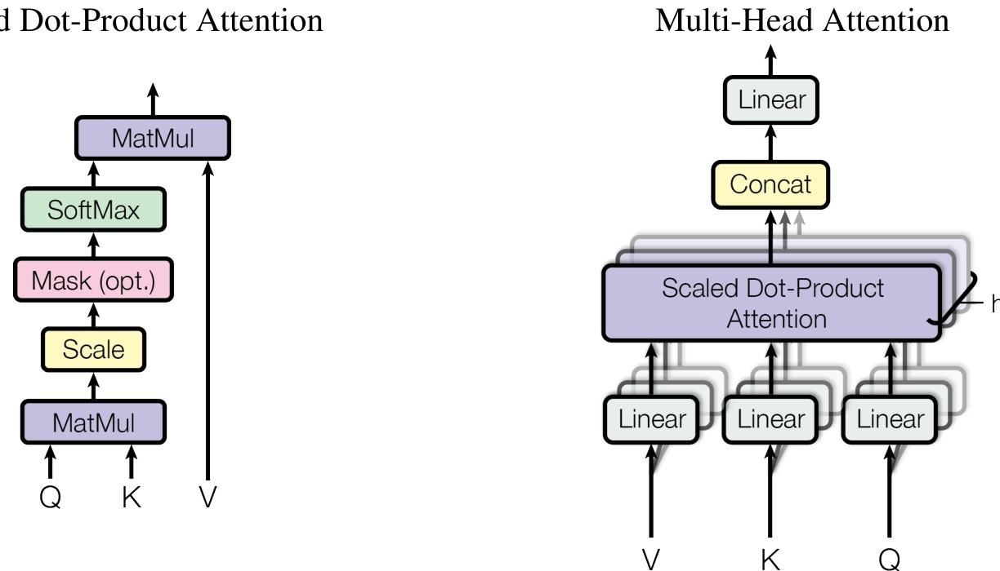

Figure 2:(left) Scaled Dot-Product Attention. (right) Multi-Head Attention consists of several attention layers running in parallel. 

of the values, where the weight assigned to each value is computed by a compatibility function of the query with the corresponding key.

#### 3.2.1 Scaled Dot-Product Attention 

We call our particular attention "Scaled Dot-Product Attention" (Figure 2). The input consists of queries and keys of dimension $d_{k}$ , and values of dimension $d_{v}$ .. We compute the dot products of the query with all keys, divide each by $\sqrt{d_{k}}$ , and apply a softmax function to obtain the weights on the values.

In practice, we compute the attention function on a set of queries simultaneously, packed together into a matrix $Q$ . The keys and values are also packed together into matrices K and V. We compute the matrix of outputs as:

$$ Attention(Q,K,V)=softmax(\frac{QK^T}{\sqrt{d_k}})V $$

The two most commonly used attention functions are additive attention [2], and dot-product (multiplicative) attention. Dot-product attention is identical to our algorithm, except for the scaling factor of $\frac{1}{\sqrt{d_{k}}}$ :. Additive attention computes the compatibility function using a feed-forward network with a single hidden layer. While the two are similar in theoretical complexity, dot-product attention is much faster and more space-effi cient in practice, since it can be implemented using highly optimized matrix multiplication code.

While for small values of $d_{k}$  the two mechanisms perform similarly, additive attention outperforms dot product attention without scaling for larger values of $d_{k}\;[3]$ . We suspect that for large values of $d_{k}.$ , the dot products grow large in magnitude, pushing the softmax function into regions where it has extremely small gradients 4. To counteract this effect, we scale the dot products by $\frac{1}{\sqrt{d_{k}}}$ 

#### 3.2.2 Multi-Head Attention 

Instead of performing a single attention function with $d_{\mathrm{m o d e l}}$ 1-dimensional keys, values and queries,we found it beneficial to linearly project the queries, keys and values h times with different, learned linear projections to $d_{k},d_{k}$ and $d_{v}$  dimensions, respectively. On each of these projected versions of queries, keys and values wethen perform the attention function in parallel yielding $d_{v}$ ,-dimensional 

4To illustrate why the dot products get large, assume that the components of q and k are independent random variables with mean O and variance 1. Then their dot product,$\begin{array}{r}{q\cdot k=\sum_{i=1}^{d_{k}}q_{i}k_{i}}\end{array}$ , has mean O and variance $d_{k}$ 